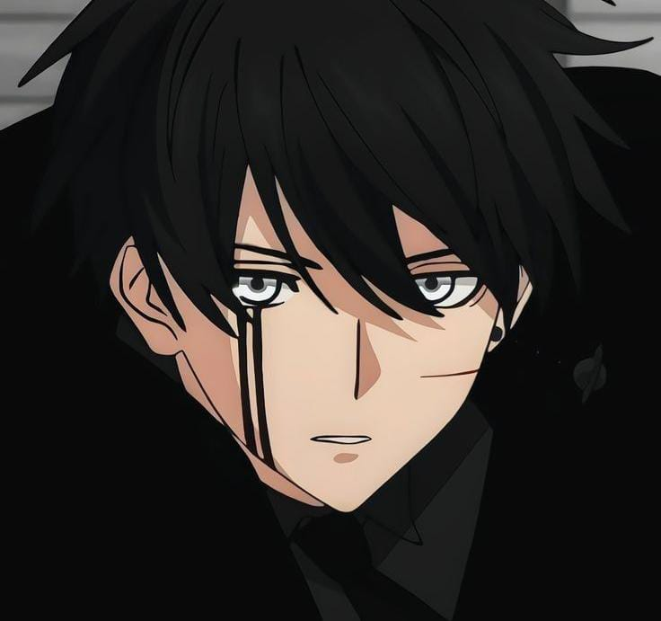
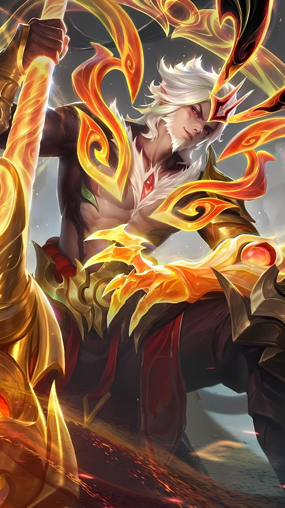

<!DOCTYPE html>
<html lang="id">
<head>
<meta charset="UTF-8">
<meta name="viewport" content="width=device-width, initial-scale=1.0">
<title>My Anime Profile</title>

</head>

<body>

<header>
  <h1>MY PERSONAL WEBSITE</h1>
  
Welcome to my anime world

</header>

  <!-- DATA DIRI -->
  <section class="card">
    <h2>About Me</h2>

    

    
Nama: Aditya idris

    
Umur: 17 tahun

    
Hobi: Gaming, Anime, dan Musik

    
Game Favorit: Mobile Legends

    
Waifu: Sistine Fibel

  </section>

  <!-- WAIFU -->
  <section class="card">
    <h2>My Waifu</h2>

    

    <h3>Sistine Fibel</h3>
    
My favorite anime character ❤️

  </section>

  <!-- MUSIK -->
  <section class="card">
    <h2>one direction 18</h2>

    
Dengarkan lagu favoritku di sini 🎵

    <audio controls loop>
      <source src="18.mp3" type="audio/mpeg">
      Browser kamu tidak mendukung audio.
    </audio>
  </section>

  <!-- MOBILE LEGENDS -->
  <section class="card">
    <h2>Mobile Legends</h2>

    

    <h3>Hero Favorit: Sun</h3>

    

      Game favoritku adalah Mobile Legends.
      Aku suka bermain bersama teman dan
      menggunakan hero favoritku.
    

  </section>

<!-- VIDEO MP4 -->
<section class="card">
  <h2>My hero mlbb</h2>

  <video controls width="100%" 
         style="max-width:500px; border-radius:12px;">
    <source src="sun starlight.mp4" type="video/mp4">
    Browser kamu tidak mendukung video.
  </video>

</section>

<footer>
  
© 2026 My Personal Website

  
Made with ❤️ by Nama Kamu

</footer>

</body>
</html>
